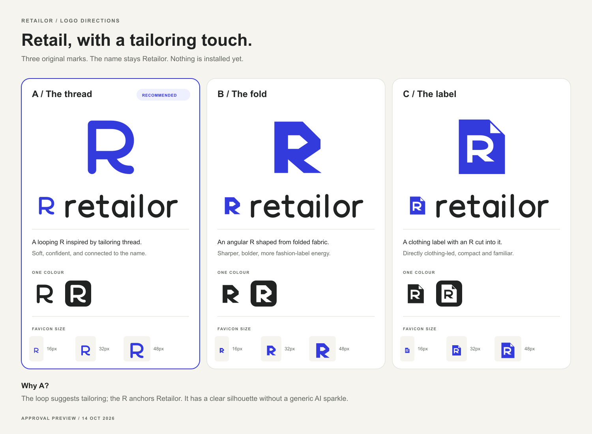

# Retailor logo review — draft 01

14 October 2026. **Owner approval pending. Nothing installed in the app.** The owner moved away from the deferred hero-film discussion and requested a better identity fitting the Retailor name, with approval before site/favicon use.

## Proposed identity

The name combines the associations of retail and tailoring. These three original R marks keep the existing cobalt `#343bdd`, ink `#202321` and warm-paper `#f5f4ef` palette. All share original rounded lowercase vector lettering so the owner can compare the symbol directions clearly. The name remains **Retailor**; the platform identity and merchant storefront identities have separate roles.

| Direction                       | Meaning and character                                                                                                                                                                            | Assets                                                                                      |
| ------------------------------- | ------------------------------------------------------------------------------------------------------------------------------------------------------------------------------------------------ | ------------------------------------------------------------------------------------------- |
| **A — The thread, recommended** | A rounded R drawn with a looping stroke and curved tail. The loop gives a subtle tailoring association while the R anchors the website name. Friendly, direct and readable in the small samples. | [Mark](logo-review/RTL-032/a-thread.svg), [lockup](logo-review/RTL-032/a-thread-lockup.svg) |
| **B — The fold**                | An angular R with a folded-fabric silhouette. More assertive, geometric and fashion-label oriented.                                                                                              | [Mark](logo-review/RTL-032/b-fold.svg), [lockup](logo-review/RTL-032/b-fold-lockup.svg)     |
| **C — The label**               | An R cut out of a clothing label with a folded corner. The most literal clothing association, with more internal detail at small sizes.                                                          | [Mark](logo-review/RTL-032/c-label.svg), [lockup](logo-review/RTL-032/c-label-lockup.svg)   |

The board includes full name/mark combinations, ink-on-white and white-on-ink examples, and native 16/32/48px PNG samples. The symbols and lettering are vector paths, with transparent counters; no external font is needed for the actual logo masters. Board annotations use system Arial. The renderer uses the already bundled Sharp library; no dependency was added. These are locally drawn original concepts, not downloaded company logos or outputs from the application's merchant-logo providers.

## After owner selection

Use the approved mark plus wordmark where the website name appears, with the mark alone for favicon surfaces. Audit platform navigation, workspace/footer and relevant references rather than blindly replacing all sparkle icons: Tailor's assistant icon and generated merchant logos represent separate identities. The owner can request a Tailor identity change separately.

Prepare a vector website master, a browser `.ico` including 16/32px, a square high-resolution PNG for the search favicon, and an appropriate touch icon. Read installed Next metadata/icon guidance before implementation, wire the selected assets through the framework's supported approach, then inspect the actual page head/assets and responsive platform surfaces. No final icon filenames or app allocation are frozen by this concept review.

Google's [current favicon guidance](https://developers.google.com/search/docs/appearance/favicon-in-search), inspected 14 October 2026, asks for a square brand-representative favicon, recommends resolution above 48px, and requires the icon and home page to be crawlable. A stable PNG URL linked from the home page is an intended search-compatible asset. Google controls recrawling/display; local installation cannot prove a Google result. No publication or indexing request is included in this review.

## Decision

**Await owner selection, refinement or rejection of these directions.** Recommendation: A. Website branding, metadata, public icon files and services were not changed. Keep the hero-film proposal deferred while other frontend feedback continues.

[Request](../tickets/RTL-032-review-retailor-logo.md) · [Allocation](../commit-plans/RTL-032.md) · [Actual checks](../validation/RTL-032.md)
