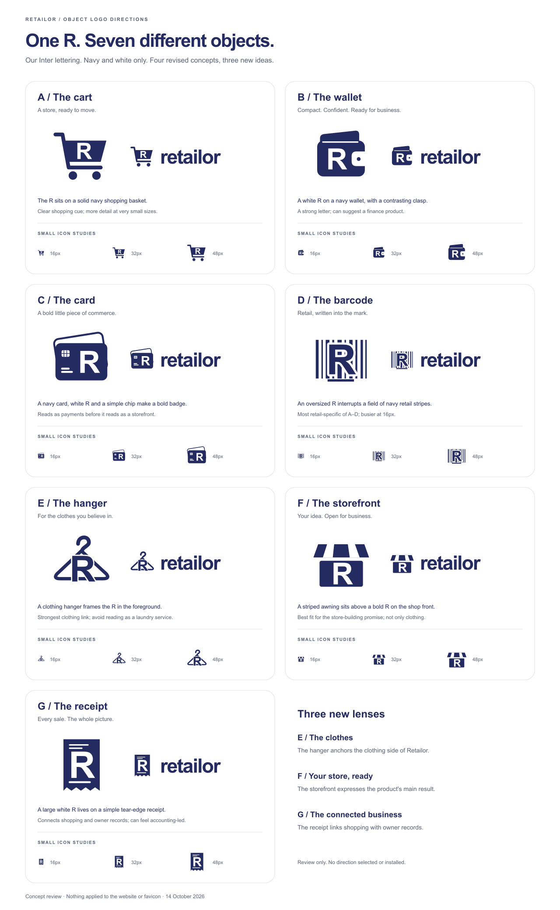

> Historical draft02, before the owner removed green and requested three more ideas. Active asset paths have since been regenerated in navy/white; this prose and its old hashes are historical, not current artwork/evidence. See the current RTL-037 review/validation.

# Retailor object-logo review — draft 02

14 October 2026. **Four directions for owner review. None selected or installed.** The owner rejects draft 01 and asks for an object with Retailor's own R/font in front: shopping cart, wallet, credit card and barcode. A shopping bag is explicitly excluded.

| Direction | Idea | Tradeoff | Editable assets |
| --- | --- | --- | --- |
| A — Cart | Lime shopping basket, navy frame/wheels and foreground R. The most immediate shopping cue. | More detail at tiny favicon sizes. | [Mark](logo-review/RTL-037/a-cart.svg), [wordmark](logo-review/RTL-037/a-cart-lockup.svg) |
| B — Wallet | A compact lime wallet with navy fold/clasp and a generous R on its front. | Strong letter/silhouette; may suggest a finance product. | [Mark](logo-review/RTL-037/b-wallet.svg), [wordmark](logo-review/RTL-037/b-wallet-lockup.svg) |
| C — Card | Navy card, lime backing/R and a small white chip. | A bold badge; reads as payments before storefronts. | [Mark](logo-review/RTL-037/c-card.svg), [wordmark](logo-review/RTL-037/c-card-lockup.svg) |
| D — Barcode | A large R interrupts navy retail stripes with a white knockout and lime underline. | Most directly tied to retail; stripes are busier at 16px. This is a brand illustration, not a functioning barcode. | [Mark](logo-review/RTL-037/d-barcode.svg), [wordmark](logo-review/RTL-037/d-barcode-lockup.svg) |

The R and lowercase name use the site's existing **Inter at weight 800**, with its navy `#242b60`, lime `#d6f578` and white. The symbols are original SVG geometry. The general object-plus-letter composition is the owner's brief; no Shopify bag, S, path or wordmark is reused. These are symbol studies, not final art approval or a claim of trademark clearance.

The board shows mark/wordmark relationships and 16/32/48px studies, with separate actual transparent PNGs at those sizes. The SVG masters embed the unmodified local WOFF2 and retain editable text; they are **not outlined-font masters**. [Exact font/source provenance](logo-review/RTL-037/provenance.json), [OFL licence](logo-review/RTL-037/FONT-LICENSE.txt). Original site font provenance remains under public/fonts. Local Sharp/Pango registers that same font for deterministic offline PNG rendering; no external font/provider/install is used.

Use [generate.mjs](logo-review/RTL-037/generate.mjs) to regenerate the self-contained SVG/HTML review, then [render.mjs](logo-review/RTL-037/render.mjs) with an existing Sharp package directory for the PNG board/native-size studies. [Actual checks and limitations](../validation/RTL-037.md). The review assets live outside application/public inputs. [Rejected draft 01](LOGO-REVIEW-DRAFT-01.md) and its original assets remain historical.

**Owner selection/refinement pending.** Nothing is changed in website logos, page metadata, browser icons or search favicons. After approval, prepare the chosen mark/wordmark and production browser/search/touch assets, inspect Next's current icon guidance and actual local branding surfaces, then use the applicable publication authorisation separately. Local work cannot guarantee Google's eventual display. The film hero remains deferred.
