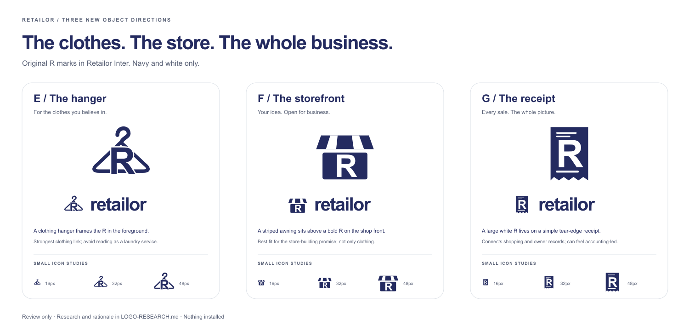
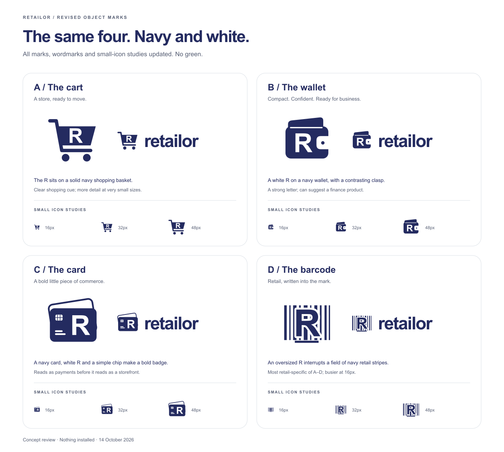

# Retailor logo review — draft03

14 October 2026. **Owner approved A, the navy/white cart, for use everywhere. Installed locally under [RTL-039](../validation/RTL-039.md).** [Production assets and usage](BRAND.md). The seven-direction study below records the options that informed that selection; the designer's earlier preference for F does not override the owner's choice.

**My strongest new direction is F, the storefront**, because it expresses Retailor's main promise: your products becoming your store. E, the hanger, is the most clothing-specific. G, the receipt, emphasizes shopping connected to the owner's business. These are design judgments, not measured market-performance claims. [Research, primary sources, candidate selection and tradeoffs](LOGO-RESEARCH.md).

| Direction      | What it communicates                     | Main tradeoff                            | SVG mark                                  |
| -------------- | ---------------------------------------- | ---------------------------------------- | ----------------------------------------- |
| A — Cart       | Shopping and movement                    | Generic retail; more tiny details        | [A](logo-review/RTL-037/a-cart.svg)       |
| B — Wallet     | A compact business object with a clear R | Finance association                      | [B](logo-review/RTL-037/b-wallet.svg)     |
| C — Card       | Bold payment-related badge               | Payments before storefronts              | [C](logo-review/RTL-037/c-card.svg)       |
| D — Barcode    | Direct retail association                | Busier at16px; not a functional barcode  | [D](logo-review/RTL-037/d-barcode.svg)    |
| E — Hanger     | Clothes and styling                      | Can suggest a cleaning service           | [E](logo-review/RTL-037/e-hanger.svg)     |
| F — Storefront | A shop ready for business                | General retail rather than only clothing | [F](logo-review/RTL-037/f-storefront.svg) |
| G — Receipt    | Shopping plus owner records              | Accounting/POS association               | [G](logo-review/RTL-037/g-receipt.svg)    |

All current marks, full-name lockups, PNG studies and comparison boards use **navy `#242b60` and white only**. The letters use the site's actual **Inter800**, with the unmodified local WOFF2 embedded in editable SVG masters. These are not outlined production masters. [Font/geometry provenance](logo-review/RTL-037/provenance.json), [OFL licence](logo-review/RTL-037/FONT-LICENSE.txt), [full seven-option board](logo-review/RTL-037/comparison.png), [actual checks](../validation/RTL-037.md).

All seven are original object silhouettes with a foreground R. No shopping bag, copied Shopify S/path/wordmark, downloaded symbol or generated merchant logo. Each has a128px SVG, full-name lockup and actual transparent16/32/48px PNG studies. These remain editable review studies. The selected cart now has a separate font-independent production vector and actual browser/search/touch exports; see [production usage](BRAND.md).

Generator and offline rasteriser remain in the review folder; no dependency, font install or external request is needed to regenerate the studies. [Rejected draft01](LOGO-REVIEW-DRAFT-01.md) and [historical draft02 prose](LOGO-REVIEW-DRAFT-02.md) remain references; active green study assets were replaced in place. RTL-039 installs A into the application and shared root favicon metadata. Google appearance depends on a later published, crawlable site and Google's processing. Film production remains deferred.
