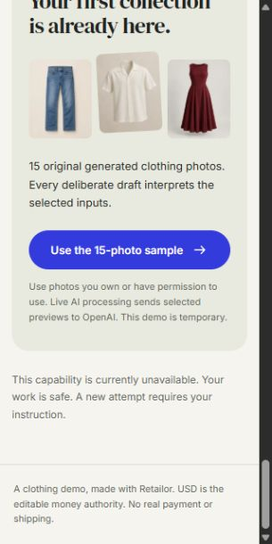

# RTL-006 execution and validation

Base: `01e4ba5` (RTL-005). Scope: combined unstaged RTL-006 implementation, relevant untracked code/docs/assets and the unchanged acceptance requirements in the complete ticket. No unrelated changes or staged files were present. Windows, Node 24.19.0, pnpm 11.25.0; fake defaults and no API keys/approved paid budget. Injected tests deny external networking. All runtime-provider requests in tests use injected clients. No push, deployment, paid call or cloud change occurred.

## Delivered local behavior

Shared strict draft/admission/model contracts; action-bound one-use grants and verified hostname/action; manifest-first actual byte/hash/multipart enforcement; owned serial raster workers and sanitized provider images; one foreground Responses request with retries zero; strict output/provenance/grouping reconciliation and honest uncertainty; deliberate public processor and cancellable challenge lifecycle; safe bridge cookies/results; preserved photos, restore fences and truthful unavailable capabilities. Policy/defaults and independent actual-image expectations live in [RECOGNITION.md](../engineering/RECOGNITION.md) and [catalogue evaluation](../evaluation/catalogue/README.md).

## Execution checks

Initial settled `pnpm check` passed format, lint, source/test types, 68-module boundary scan, 157 tests across 25 files and both production builds. After the owned image-envelope/Strict Mode corrections, all gates passed again with 158 tests; that snapshot entered validation pass 1. Subsequent final gate evidence is recorded below after the findings are resolved.

Focused meaningful evidence covers actual JPEG decoding, exact hashes, corrupt/metadata-bearing images, manifest/file coverage, bad proof/host/action, stale/wrong-bound/boot grants, duplicate approval/execution, concurrent slots and mid-dispatch cancellation, zero retry on provider service errors, refusal/incomplete/malformed output, invented/dangling sources, unsupported copy/facts, strict cookie/result forwarding and public capability failure without a fallback. A raw chunk stream with no Content-Length independently hits the 19 MiB cap; HTTP file/metadata caps also reject before any provider call. A malformed Supertest request combining Content-Length and Transfer-Encoding was corrected; its protocol rejection was not counted as application limit evidence.

The exact 15 shipped assets were independently decoded/sanitized. A separate 24-small-raster batch proves count handling. A near-cap 24-raster batch submitted **18,056,233 bytes** and produced **9,392,466 sanitized bytes**; parent-owned serial handling took **19,670 ms** in the focused run and **20,745 ms** in the initial settled full run. These are local pixel/resource observations, not clothing quality, provider token usage or real request latency. No test claims a paid 12,000-token batch succeeded.

## Actual browser observations

The existing in-app browser exercised the public branch from a temporary production-build preview at `127.0.0.1:4312/demo` with `RETAILOR_DEV=false`, fake/paid-off backend and no secrets. The preview's PID/start time/script/descendant ownership was verified; it was stopped after checking. Retailor 4310/4311 and unrelated repositories 3000/4000 remained running. No occupied port was taken over.

Loading the actual sample selected 15 available photos without processing. Clicking Review & process 15 photos returned the safe unavailable notice and retained all 15, with no catalogue success. No Cloudflare script loaded. Reload restored all 15 visible, loaded image elements and the enabled deliberate processing CTA; no processing request repeated. Reset cleared only the disposable 4312 workspace before stopping its preview. The browser returned to 4310 and its viewport override was reset.

At width 320/375/768/1024/1280/1440/1920, the paid-off selection/error view showed no horizontal overflow. The 320×640 screenshot displays the readable unavailable notice. This supplements RTL-005's actual review/process/responsive evidence; it does not prove a real challenge widget, paid recognition output, physical devices, owner visual approval or actual 200% browser zoom.

[Full 1280-pixel preserved selection](../research/evidence/RTL-006/unavailable-1280.png).

## Read-only validation pass 1

TL;DR: the intended admitted fresh-vision path is connected and most local criteria are covered; two concrete availability/abuse defects prevent completion.

Verdict: **Does not yet meet ticket**. No edits, index changes, installations, full-suite run, paid calls or delegation occurred during this time-boxed pass. Reviewed current relevant diff/untracked files against the complete ticket and its precision constraints, and read `git diff --check` (clean). Existing execution gate results were evidence, not checks rerun by validation. Ticket diff changed only status, without weakening requirements.

- **Medium — truthful capability:** `apps/backend/src/runtime/compose.ts:57` (pre-fix) emitted vision ready permanently while `security/admission.ts:266` rejected spent process budget as BUSY. Retained dispatched reservations do not auto-expire, so another visitor could keep completing approvals for an unavailable capability.
- **Medium — bounded pre-dispatch admission:** `apps/backend/src/security/admission.ts:190` allocated workspace state before rate rejection and retained records after failed proofs at `:229` (pre-fix). Invalid-proof requests could fill the 256-entry ledger without ever passing a challenge.

Coverage: shared sample/upload path, exact byte/multipart enforcement, one zero-retry call, output/photo coverage, honest uncertainty, safe photo retention, stale/replay fencing: **Covered**. Truthful capability and robust baseline admission allocation: **Partial** pending fixes. Actual paid semantic quality/usage/latency/retention, genuine challenge and hosted identity: **Unverified external evidence** with explicit prerequisites; no absent key is treated as a local code failure.

## Independent finding dispositions

Execution added two focused regressions before modifying production code. Both failed for the reviewed reasons: configuration stayed true after spending the only reservation, and the 257th invalid workspace received BUSY instead of rejecting its proof. Execution then corrected allocation/release and dynamic availability. The focused admission/runtime suite passed **13 tests**: 300 invalid proofs no longer consume the workspace ledger, zero budget performs zero challenge verification, exhausted vision becomes unavailable, and retained verified/replay/concurrent/usage behavior still passes. Final settled revalidation follows below.

## Read-only validation pass 2

TL;DR: both earlier findings are resolved with independently reproduced regressions, but the exact allowed multipart boundary has a new concrete defect.

Verdict: **Does not yet meet ticket** pending the boundary correction. Reassessed the complete relevant worktree without edits or a suite run during review. Dynamic budget availability/early proof rejection and invalid-proof ledger release were confirmed in the actual implementation and focused coverage. Prior findings: **Resolved**. Newly inspected pinned Busboy 1.6.0 source (`lib/types/multipart.js:548`) emits `partsLimit` when its last allowed part completes. The application treated that event as overflow at `apps/backend/src/catalogue/multipart.ts` (pre-fix `parts:25`), rejecting one manifest plus exactly 24 valid files.

- **Medium — full batch enforcement:** the exact allowed 24-photo production transport was **Partial** despite the separate 24-raster sanitization proof; the early error prevents any provider dispatch on that valid boundary. Other local criteria remain **Covered**, with the same external evidence **Unverified**. Checks were the settled diff/nearby pinned parser code and existing execution evidence; no validation mutation, delegation or paid call occurred.

Execution independently added an exact 24-file HTTP regression before changing production code; it failed **413 versus expected 200**. The parser now allows its sentinel 26th part while the application still permits only one metadata field and 24 files. The focused regression passes: all 24 files reach exactly one injected provider call; a 25th file is rejected **413 with zero provider calls**. The earlier full gate snapshot had 160 passing tests; it predates this final boundary correction and is not used to claim the corrected snapshot passed.

## Read-only validation pass 3 and settled gates

TL;DR: the admitted fresh-recognition path and its local failure/resource boundaries meet the complete packet; actual paid/hosted behavior remains explicitly unverified.

Verdict: **Meets ticket for its required local outcome**. **No actionable findings**. Previous availability/ledger findings remain resolved; the exact boundary finding is resolved by the independently failing-then-passing HTTP regression, including zero-call rejection of the additional file. Reassessed the complete relevant implementation, strict shared contracts, real public composition, ownership/error/replay/cancellation paths, docs and focused evidence. No edits, index changes, installations, full-suite run, paid access or delegation occurred during this pass; `git diff --check` was clean and staged scope was empty.

Coverage: shared sample/upload production path; verified bound admission; actual hashes/bytes/count/transport caps; one call with zero retries; output/source/mandatory-photo reconciliation; honest uncertainty/non-clothing; retained usable photos/no public fallback; stale/reset/cancel/replay fences; safe truthful capability/error/log behavior: **Covered locally**. Real challenge, paid semantic quality, account retention/usage/latency/cost, physical/zoom/owner visuals and Linux/hosted evidence: **Unverified external prerequisites**, retained without waiver.

Execution's final `pnpm check` after all code fixes passed all six gates: formatting, lint, source plus test type checking, **68 modules** in boundaries, **161 tests across 25 files**, backend compiled output and Next 16.4 production build. Final near-cap measurement: 18,056,233 input bytes, 9,392,466 provider bytes, **18,765 ms**. The test suite took 37.00 seconds; actual provider time is not inferred from it. Docs-only completion/status updates follow this clean code snapshot and receive a final read-only consistency check before commits.

## External prerequisites retained

RTL-020: owner-authorized key/project, real Turnstile configuration, account retention/eligibility, independent clothing/non-clothing/label/multi-view/attack assets and reviewed policy; measure quality, grouping, actual tokens/latency/cost and accept or replace `gpt-6-luna`. No paid policy approval or budget is inferred from source documentation. RTL-019: physical/browser/device matrix, owner feedback and real zoom. RTL-021/022: Linux native/memory and hosted IAM/probes. Future Tailor/logo actions must own their own schemas and allowances before reusing this boundary. Public store activity/publication still integrates RTL-011's scenario ownership.

Final docs-only consistency review: **No actionable findings**. Nine checked local criteria retain their original wording; queue/blueprint select RTL-007 and keep paid/account/hosted evidence pending. UTF-8, links, safe defaults, actual gate counts and explicit staged file allocations were checked. No source changed after the final gates. Code commits: `5fcced0` (contracts), `2ffe14e` (backend), `72bf9dd` (frontend). The following documentation commit records the verified handoff.
## Owner-prioritized backend image concurrency — 12 October 2026

Base `9ce202e`, after RTL-003's verified browser/sample/recovery follow-up and before RTL-016. [Retrosum research and the precise allocation](../engineering/IMAGE-CONCURRENCY.md) explain the difference between independent PDF requests and Retailor's joint catalogue interpretation. The full original recognition/admission outcome stays intact.

The active sanitizer now preflights every actual hash/header before native allocation, then runs two bounded request loops under a shared process-wide two-worker/two-waiter gate. Each loop holds one result until approved-manifest order commits. Cancellation/failure aborts request siblings and queued starts and waits for decoder termination before capacity and admission release. A defensive private 640-MiB RSS check rejects before starting another native worker; this is not a guaranteed process/container memory ceiling. Safe BUSY propagates without provider dispatch. Signed grants, one paid operation/workspace, two/process, two attempts, 18/19-MiB transfer, 120/95-second deadlines and zero SDK retries remain unchanged. One joint catalogue model call follows only a complete valid batch. No keys, networking, provider call, new dependency, queue service, source persistence or cloud action was introduced by this follow-up.

### Actual checks and reproducible local measurement

Windows / Node 24.19.0 / pnpm 11.25 / existing owned 4310/4311 runtime; no sibling service stopped or secret read. Unit setup forces paid-off and denies external networking. `pnpm exec vitest run apps/backend/src/catalogue/routes.test.ts apps/backend/src/catalogue/sanitize.test.ts apps/backend/src/catalogue/image-capacity.test.ts` passed **18 tests / 3 files** at **23:01:06 Cairo**. They cover reversed bounded completion, shared two active/two waiting slots/fifth rejection, independent cancellation, no release before stop, all-input preflight, high-RSS no-work rejection, and HTTP zero provider calls/unspent reservation release. Real 24-file multipart, fifteen-asset and near-cap raster cases also passed.

`pnpm --filter @retailor/backend exec tsx test/sanitizer-benchmark.ts` ran identical bytes/policy under one-slot/two-slot conditions, order **1,2,2,1**, in one process. The harness forces fake/paid-off, denies fetch and imports no provider/startup. It reads the public assets and independently generates 24 noisy JPEGs at 1600×1600/quality 35 with seed `0x12345678`; the existing route test uses seed `12345`, so its timing is separate. Test-helper inclusion in root `tsconfig.tests.json` exposed the constructor's inferred literal-2 parameter; its explicit number annotation was corrected and runtime validation still permits only 1 or 2. The successful benchmark runtime and output hashes were unchanged by that type-only fix.

| Case | One slot, ms | Two slots, ms | Same normalized output | Largest 20-ms sampled RSS |
| --- | --- | --- | --- | --- |
| Fifteen public photos | 5,865; 5,847 (mean 5,856) | 3,368; 3,338 (mean 3,353) | 1,406,012 input / 1,221,616 output bytes; same hash in all four trials | 255,651,840 bytes (~243.81 MiB) |
| 24 synthetic noisy rasters | 19,955; 20,446 (mean 20,200.5) | 10,980; 11,507 (mean 11,243.5) | 18,054,979 input / 9,387,284 output bytes; same hash in all four trials | 335,507,456 bytes (~319.96 MiB) |

Observed maximum active counts matched 1 or 2; every trial finished with zero active/waiting slots. The [full scalar comparison record](evidence/RTL-006-concurrency/worker-comparison.json) contains exact platform/time/count/byte/hash observations. Sampled RSS includes that benchmark process and is not guaranteed peak, isolated-machine performance, two maximum-size simultaneous HTTP/model stages, Linux or hosted memory evidence. Other local apps remained running. Measurements establish local preprocessing improvement for these inputs, not whole live AI latency, account throughput, conversion or a production SLA. No corpus bytes or private provider data are stored in the record.

Final `pnpm check` passed all required settled gates: format, lint, source/test typechecks including the harness, **146 boundary modules**, **308 tests / 55 files**, and backend / Next production builds. Unit start **23:10:07 Cairo**, duration **33.60 seconds**; the existing near-cap case observed 12,132 ms under that separate suite load. Production `.next` and dev `.next-dev` remain separate. This backend-only change has real raster/HTTP evidence; no paid browser/hosted result is inferred from injection.

### Read-only validation pass 1

**TL;DR:** this past-ticket follow-up makes local image sanitization overlap while preserving joint recognition, resource ownership, approved order and paid admission. The connected implementation and real local comparison satisfy that scope. Paid/account/device and Linux/hosted capacity remain explicitly pending.

**Verdict: Meets follow-up. No actionable findings.** Read-only review against the full RTL-006 ticket, its latest owner criteria and relevant transport/privacy/resource authority, over the combined unstaged/untracked change from `9ce202e`. Inspected source, injected ports, default native worker termination path, process gate, route cleanup/error mapping, owning tests, benchmark/harness inclusion, scalar evidence and final required gates. No source/index edited, no full suite rerun, no paid/network/cloud call and no delegation during this pass.

| Requirement | Coverage |
| --- | --- |
| Original admitted single-dispatch / source coverage / strict failures / no fake fallback | Covered, retained existing adapter and signed transport, real raster/multipart regressions. |
| Two actual native slots and bounded foreground waiters across requests | Covered, shared default gate; injected two-request/fifth rejection; actual benchmark active counts. |
| Stable approved order and normalized byte bounds | Covered, reversed completion tests, all-input hash/header preflight and existing actual fifteen/24-image bounds. |
| Failure/abort waits for stop and releases only owned resources | Covered, default terminate-before-settle path, injected cancellation and HTTP admission held until final sibling stop; no provider dispatch or spent reserve. |
| Honest controlled local time/memory and unchanged inference/attempt/budget policy | Covered, same-output four-trial comparisons and explicit sampling/background-app limitations; one joint model batch unchanged. |
| Required gates/docs/release handoff | Covered; all settled gates above, correct HTTP versus CPU versus paid limits and later hosted memory criteria. |

Local release preparation must preserve two native workers/two waiters separately from HTTP concurrency and paid capacity. RTL-022 must measure simultaneous maximum bodies, decoder and Base64/model/response stages plus cancellation on the actual Linux/hosted candidate before increasing limits. Keys, paid budget/policy/account support and bounded live authorization remain necessary for RTL-020/022. This does not block independent local work; RTL-016 is next. No original or required local behavior was waived.
